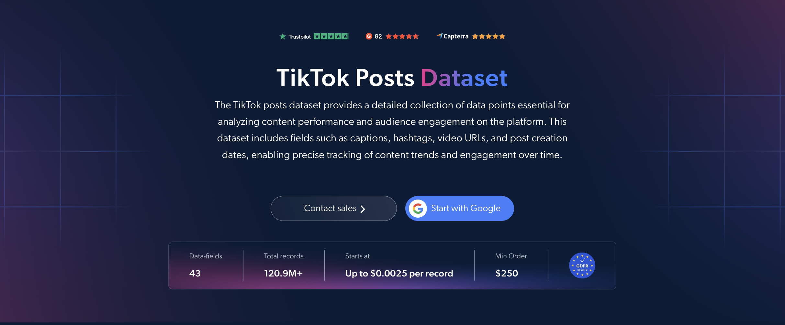

# TikTok-Posts-dataset-samples

<h2>A sample dataset of 1000 TikTok posts</h2>

<a href="https://brightdata.com/products/datasets/tiktok/posts">
   
</a>

A TikTok dataset sample of 1000 public posts. Dataset was extracted using the <b>Bright Data API</b>.

<h2>Some of the data points that are included in the dataset:</h2>

* ```url```: URL of the TikTok post
* ```post_id```: Unique identifier for each post
* ```description```: Caption of the post
* ```create_time```: Date and time the post was created
* ```post_type```: Type of post, such as video or image
* ```video_duration```: Length of the video
* ```hashtags```: Hashtags used in the post
* ```play_count```: Number of video plays
* ```digg_count```: Number of likes
* ```comment_count```: Number of comments
* ```num_share_count```: Number of shares
* ```collect_count```: Number of times the post was saved
* ```original_sound```: Sound used in the post
* ```music```: Details of the music used in the video
* ```region```: Country of origin of the video
* ```commerce_info```: Whether the post includes shopping, promotional or affiliate content
* ```profile_username```: Username of the account that posted the content
* ```profile_url```: URL of the account's TikTok profile
* ```profile_followers```: Number of followers of the account
* ```is_verified```: Whether the account is verified
* ```preview_image```: Preview image of the post
* ```carousel_images```: Images in carousel-type posts
* ```subtitle_info```: Subtitle details for the video

And a lot more.

This is a sample subset which is derived from the "TikTok Posts (public data)"
dataset which includes more than <b>120,900,000 posts</b>.

Available dataset file formats: <b>JSON, NDJSON, JSON Lines, CSV, XLSX, or Parquet. Optionally, files can be compressed to .gz</b>.

Dataset delivery type options: <b>Email, API download, Webhook, Amazon S3, Google Cloud storage, Google Cloud PubSub, Microsoft Azure, Snowflake, SFTP</b>.

Update frequency: <b>Once, Daily, Weekly, Monthly, Quarterly, Biannual, or Custom basis</b>.

Data enrichment available as an addition to the data points extracted: <b>Based on request.</b>

<b>[Get the full TikTok Posts dataset](https://brightdata.com/products/datasets/tiktok/posts)</b>.

<a href="https://brightdata.com/products/datasets/tiktok/posts">
</a>

<h2>What are the TikTok Posts datasets use cases?</h2>

<h3>1. Influencer discovery</h3>
Brands use TikTok posts datasets to find creators whose content actually performs. Going beyond follower counts, they assess true reach through plays, likes, shares, saves and comments to identify creators whose posts consistently drive engagement.

<h3>2. Trend, hashtag and sound tracking</h3>
Marketers track which captions, hashtags, sounds and music tracks are gaining traction over time. Spotting emerging trends early helps shape content calendars and pick audio for campaigns while it is still rising.

<h3>3. Competitive intelligence</h3>
Companies analyze how competitor content performs by comparing plays, likes, shares, saves and comment counts across their TikTok posts. This reveals recurring themes, posting frequency and what resonates with shared target audiences, helping sharpen content and positioning strategies.

<h2>Free access to web scraping tools and datasets for academic researchers and NGOs</h2>

The Bright Initiative offers access to Bright Data's <b>[Web Scraper APIs](https://brightdata.com/products/web-scraper)</b> and <b>[ready-to-use datasets](https://brightdata.com/products/datasets)</b> to leading academic faculties and researchers, NGOs and NPOs promoting various environmental and social causes. You can submit an application <b>[here](https://brightinitiative.com)</b>.
